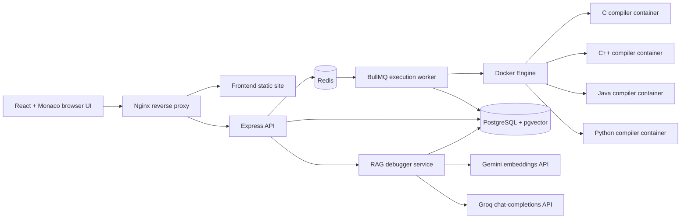

# Web Compiler

A browser-based coding environment for writing and executing C, C++, Java, and Python, with asynchronous Docker-based execution and a retrieval-augmented generation (RAG) debugger that uses compiler/runtime output and a curated knowledge base to suggest targeted fixes.

## Features

- **In-browser editor** powered by Monaco Editor.
- **Four languages:** C, C++, Java, and Python.
- **Compile and run:** submissions are queued and processed asynchronously by a BullMQ worker.
- **Separate execution containers:** each run launches a language-specific Docker image. The worker configures no network access, a 256 MiB memory limit, a 0.5 CPU limit, a PID limit, and a five-second runtime timeout in the language runner.
- **Standard input and output:** provide stdin and inspect stdout, stderr, exit status, and execution results.
- **AI debugging:** for compile errors, runtime errors, and timeouts, request a diagnosis based on the source code, execution output, and retrieved knowledge.
- **RAG knowledge retrieval:** curated Markdown debugging notes are chunked and embedded with Gemini embeddings, stored in PostgreSQL/pgvector, and retrieved using vector search plus PostgreSQL full-text search with reciprocal-rank fusion.
- **Accounts and projects:** registration/login, project management, and autosave support.
- **Monitoring components:** Prometheus, Grafana, and cAdvisor are included in the Compose configuration.

## Architecture



### Request flows

**Code execution**

1. The frontend sends code, language, and stdin to the backend.
2. The backend creates an execution job in BullMQ/Redis.
3. The worker creates a temporary workspace and starts the appropriate compiler image through the Docker Engine socket.
4. The compiler container compiles and runs the program, then returns output and an exit status.
5. The worker saves the result; the frontend polls the execution-status endpoint.

**AI debugging**

1. The frontend sends the source code and execution diagnostics to the backend's `/debug` endpoint.
2. The retrieval service creates a query embedding and performs vector and keyword searches against the knowledge base.
3. The ranked context and execution details are sent to the Groq chat-completions API.
4. The API returns a structured diagnosis with the problem, cause, suggested fix, updated code, and confidence level.

## Tech stack

| Layer | Technologies |
|---|---|
| Frontend | React, Vite, Monaco Editor, Tailwind CSS, Axios, React Router |
| API | Node.js, Express |
| Background jobs | BullMQ, Redis, Dockerode |
| Execution | Docker, GCC, OpenJDK, Python |
| Database | PostgreSQL 17 with pgvector |
| RAG embeddings | Google Gemini embedding API (`gemini-embedding-2`, 768 dimensions) |
| Debugging LLM | Groq API (`openai/gpt-oss-120b`) |
| Reverse proxy | Nginx |
| Monitoring | Prometheus, Grafana, cAdvisor |

## Repository layout

```text
.
├── app/
│   ├── backend/
│   │   ├── knowledge/          # Curated language-specific debugging notes
│   │   ├── scripts/             # Knowledge initialization and ingestion
│   │   ├── src/
│   │   │   ├── controllers/     # HTTP controllers
│   │   │   ├── migrations/      # SQL migrations
│   │   │   ├── routes/          # API routes
│   │   │   └── services/        # Execution, projects, RAG, retrieval, etc.
│   │   └── tests/               # Retrieval evaluation script
│   ├── frontend/
│   │   └── src/                 # React UI, pages, components, API clients
│   └── worker/
│       └── src/                 # BullMQ worker, Docker execution, temp files
├── infra/
│   ├── docker/{c,cpp,java,python}/  # Compiler images and runner scripts
│   ├── nginx/default.conf
│   └── prometheus/prometheus.yml
├── docker-compose.yml
└── README.md
```

## Prerequisites

- Docker Engine and the Docker Compose plugin
- A Groq API key for AI debugging
- A Google Gemini API key for embedding queries and initializing the knowledge base
- Enough local resources to build and run the application and compiler images

The worker communicates with the host Docker daemon through `/var/run/docker.sock`. This requires a Docker host and is not compatible with every managed container-hosting platform.

## Configuration

The Compose file loads environment variables from `app/backend/.env` for the backend, worker, PostgreSQL, and knowledge initializer. The frontend reads `VITE_API_URL` at **build time** from its own environment file.

1. Create the backend environment file:

   ```bash
   cp app/backend/.env.example app/backend/.env
   ```

2. Edit `app/backend/.env` and provide the values below. Do not commit this file or share its secrets.

   ```dotenv
   # API
   PORT=5000
   NODE_ENV=production
   FRONTEND_URL=http://localhost:9080
   JWT_SECRET=replace-with-a-long-random-secret

   # PostgreSQL (the Compose service is named postgres)
   POSTGRES_USER=webcompiler
   POSTGRES_PASSWORD=replace-with-a-strong-database-password
   POSTGRES_DB=webcompiler
   POSTGRES_HOST=postgres
   POSTGRES_PORT=5432

   # Redis (the Compose service is named redis)
   REDIS_HOST=redis
   REDIS_PORT=6379

   # External AI services
   GROQ_API_KEY=your-groq-api-key
   GEMINI_API_KEY=your-gemini-api-key

   # Worker workspace paths
   WORKER_TEMP=/app/temp
   HOST_WORKER_TEMP=/absolute/path/to/Web-Compiler/app/worker/temp
   ```

   Generate a random JWT secret, for example with `openssl rand -hex 32`. Replace `HOST_WORKER_TEMP` with the **absolute path on the Docker host** to this repository's `app/worker/temp` directory. The worker uses it to bind each temporary workspace into the execution container. The checked-in environment example currently does not list `WORKER_TEMP` or `HOST_WORKER_TEMP`, but the worker code expects them.

3. Create the frontend environment file:

   ```bash
   cp app/frontend/.env.example app/frontend/.env
   ```

   Set the API base URL for the default local Compose configuration:

   ```dotenv
   VITE_API_URL=/api
   ```

   Vite embeds this value into the frontend bundle at build time, so rebuild the frontend after changing it.

4. Create the worker temp directory and secure the backend environment file:

   ```bash
   mkdir -p app/worker/temp
   chmod 600 app/backend/.env
   ```

   Ensure `HOST_WORKER_TEMP` points to the absolute path of the directory created above.

### Environment variables at a glance

| Variable | Used by | Purpose |
|---|---|---|
| `PORT` | Backend | Express listen port (Compose/Nginx expect 5000) |
| `FRONTEND_URL` | Backend | Allowed frontend origin for CORS |
| `JWT_SECRET` | Backend | JWT signing/verification secret |
| `POSTGRES_*` | Backend, PostgreSQL | Database connection and initial database credentials |
| `REDIS_HOST`, `REDIS_PORT` | Backend, worker | Redis connection |
| `GROQ_API_KEY` | Backend | LLM-based debugging |
| `GEMINI_API_KEY` | Backend | Embedding generation and knowledge ingestion |
| `WORKER_TEMP` | Worker | Workspace path inside the worker container; use `/app/temp` with the current Compose mount |
| `HOST_WORKER_TEMP` | Worker | Absolute workspace path on the Docker host, used for bind-mounting execution workspaces |
| `VITE_API_URL` | Frontend build | API prefix used by browser API clients; `/api` works with the included Nginx config |

The root `.env.example` is not referenced by the current Compose file. Use the backend and frontend examples above.

## Run locally with Docker Compose

Run these commands from the repository root:

```bash
# Build the application and compiler images, then start services
docker compose up -d --build

# Check service state
docker compose ps

# Follow logs
docker compose logs -f backend worker nginx
```

Open [http://localhost:9080](http://localhost:9080).

The first startup waits for PostgreSQL to become healthy and runs the `knowledge-init` service. Knowledge ingestion calls the Gemini embedding API, so `GEMINI_API_KEY` must be configured before first initialization. The backend also runs SQL migrations during startup.

To stop the services:

```bash
docker compose down
```

This leaves the named database and Grafana volumes intact. **Do not use `docker compose down -v` unless you intentionally want to delete persisted data.**

## API surface

The Express application mounts these route groups:

| Prefix | Purpose |
|---|---|
| `/health` | Basic backend health response |
| `/auth` | Authentication |
| `/execute` | Submit code for execution |
| `/execution` | Retrieve execution status/results |
| `/projects` | Project operations |
| `/debug` | RAG-based debugging |
| `/metrics` | Prometheus client metrics |

With the included Nginx configuration and `VITE_API_URL=/api`, browser API requests use the `/api` prefix and Nginx forwards them to the backend.

## RAG retrieval evaluation

The repository includes a retrieval evaluation script at `app/backend/tests/evaluate-retrieval.js`. It evaluates six queries across C++, Python, and Java, checking whether the expected knowledge document appears in the top five retrieved results. It prints each result's ranking and a summary including top-k accuracy and mean reciprocal rank (MRR).

Run it from the backend container after the database and knowledge base are initialized:

```bash
docker compose exec backend node tests/evaluate-retrieval.js
```

The script loads the backend environment and connects to PostgreSQL. It exits with a non-zero status if a test cannot run or an expected document is missing from the top five. Report evaluation numbers alongside the test cases and evaluation date; retrieval quality can change when the knowledge base, embedding model, or ranking logic changes.

## Security considerations

This project executes user-submitted programs. Do not expose it publicly without a dedicated security review.

- **Docker socket access is highly privileged.** The worker mounts `/var/run/docker.sock`; a compromised worker may gain control of the host Docker daemon. This is not equivalent to a strong security boundary.
- **Execution containers are not a complete hostile-code sandbox.** The current worker configures no container network, 256 MiB memory, 0.5 CPU, and a PID limit of 50. Runner scripts apply a five-second program timeout. Review filesystem access, user privileges, capabilities, syscall filtering, disk/output limits, and concurrent-job controls before public deployment.
- **Rate limiting and queue controls:** add request rate limits, queue-depth limits, concurrency limits, and abuse monitoring before accepting untrusted public traffic.
- **Secrets:** keep `.env` files out of Git; rotate keys if exposed. Use strong database passwords and JWT secrets.
- **Network exposure:** do not publish PostgreSQL, Redis, the Docker daemon, or monitoring dashboards directly to the internet. Restrict SSH and expose only the intended web entry point.
- **Monitoring ports:** the current Compose file publishes Prometheus on `9090`, Grafana on `3000`, and cAdvisor on `9180` on all host interfaces. Restrict or remove these port mappings before running on a public server.
- **Reverse proxy:** the default Compose file publishes Nginx on port `9080`, not standard HTTP port `80`. Adjust the mapping and configure HTTPS appropriately for a public deployment.
- **External API costs and quotas:** Gemini embedding and Groq debugging calls depend on provider terms, quotas, and billing settings. Review those independently of infrastructure hosting costs.

## Limitations and future work

Potential next steps, depending on deployment goals:

- Strengthen execution isolation and add abuse-resistant rate/concurrency/queue limits.
- Add HTTPS, restricted monitoring access, and production-oriented secret management.
- Expand and regularly re-evaluate the debugging knowledge base and retrieval test set.
- Add more execution tests covering timeout, malformed input, large output, and cleanup behavior.
- Document deployment-specific settings and resource requirements after testing on the target host.

## Contributing

Issues and pull requests are welcome. For changes to execution or retrieval, include reproducible steps and tests where practical. Never submit API keys, `.env` files, or sensitive execution data.

## License

No explicit license file was present in the repository archive at the time this README was prepared. Add a `LICENSE` file before describing the project as open source or granting reuse permissions.
